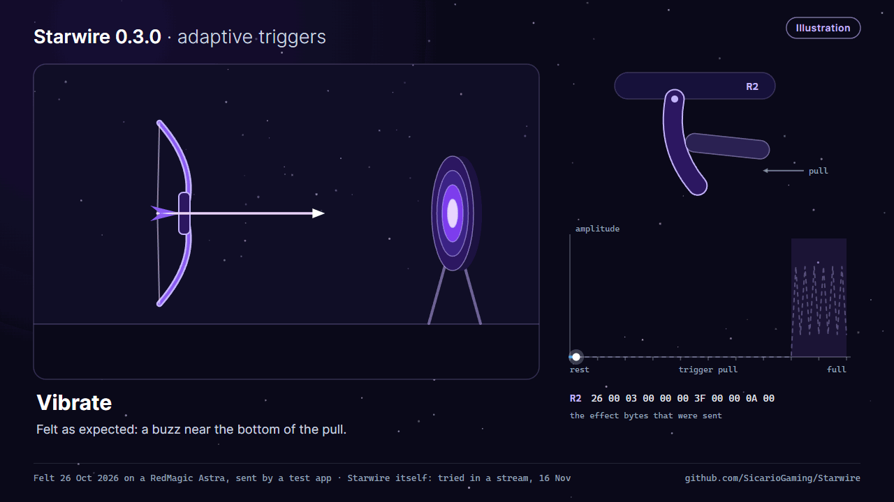
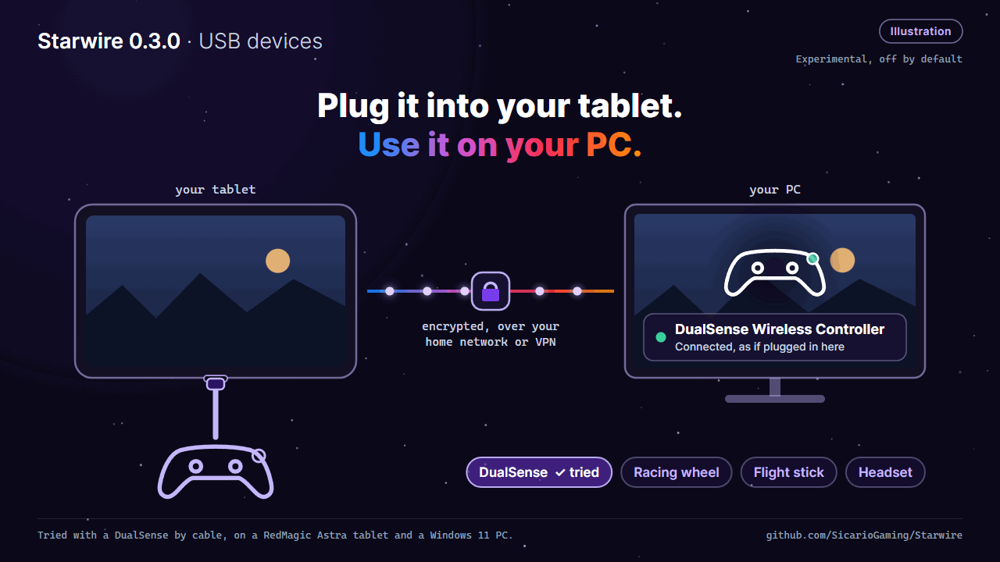
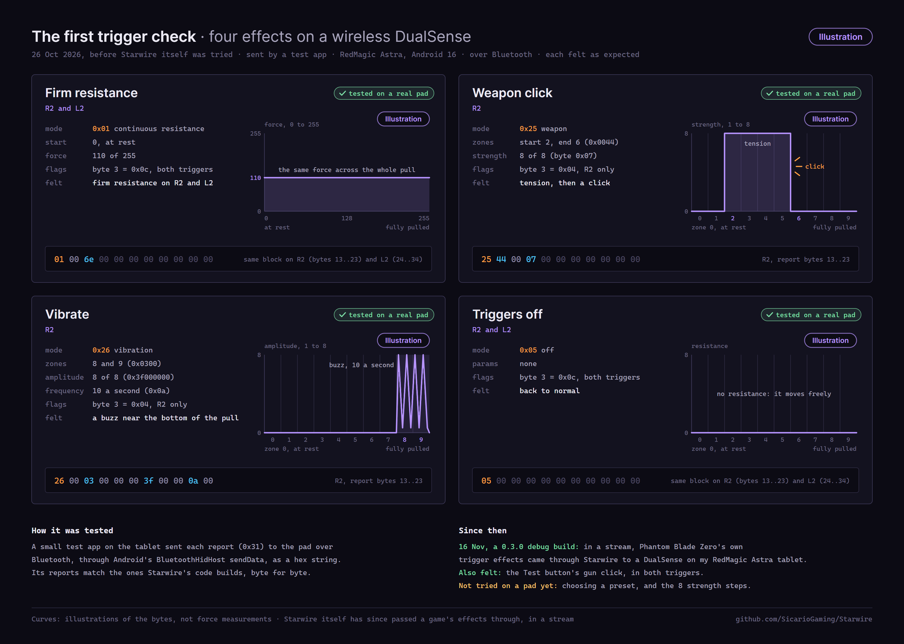
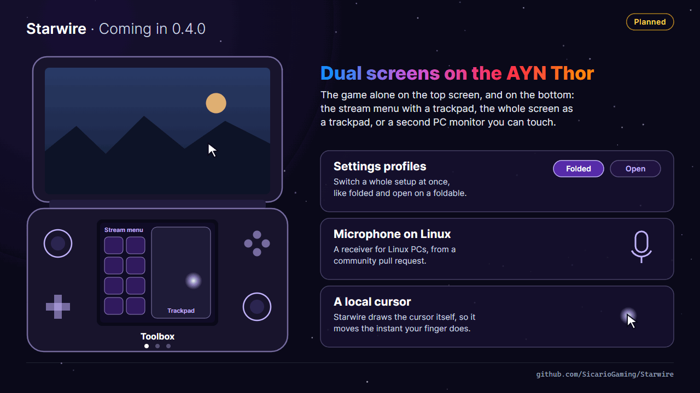

Starwire 0.3.0 is now out! This release has two flagship features: DualSense adaptive triggers over Bluetooth, and USB device passthrough from your Android device to your PC. Both were requested on the [0.2.0 post](https://www.reddit.com/r/MoonlightStreaming/comments/1xd12x5/starwire_020_mic_passthrough_wo_needing_to_modify/): u/satanasluciferi asked for full DualSense support, and u/Mugas90 asked for USB passthrough like Moonlight V+ offers.

Android does not give apps a public way to send trigger effects to a DualSense over Bluetooth. Vibepollo already sends a game's trigger effects to the client when it emulates a DualSense, so Starwire now passes those effects on to the controller through a hidden Android Bluetooth function, using an approach ported from Moonlight V+. USB passthrough works differently: a wired device plugged into your Android device, such as a controller, a racing wheel or a headset, is shared with your PC over an encrypted connection, and Windows sees it as though it were plugged into the PC directly. Both features are Experimental and switched off by default, because they rely on parts of Android and Windows that I cannot fully control.

One thing I want to reiterate: I continue to use Starwire as my daily driver, and so I will continue to update it. These continued updates are due to my own usage and the trust existing users have put in me and this project. I know this community is going through major fork exhaustion, and I don't want you to feel like there is a pressing need to change a client that already works for you. I am confident Starwire can and will go punch-for-punch with any Android client out there. We may never beat the AI-slop allegations, but I endeavor to try. Aside from that, I've spent the last few weeks dealing with an uptick of work from my day job, and with my free time, playing the hell out of Phantom Blade Zero through Starwire as we wait for GTA 6. Highly recommended if you're into Soulslike's and don't mind some QoL improvements forced on you. This time has also given me the opportunity to thoroughly use and test the previous 0.2.1 build, and the new 0.3.0 build at 4K 165 FPS with DS Haptics. I also see that there have been a few pull requests on the GitHub repo - I promise to get to that as soon as possible!

<table>
<tr>
<td width="50%" valign="top"> What three trigger effects feel like, drawn. Each was felt on a real DualSense on 26 October, sent by a test app, and Starwire itself has since passed a game's own effects through in a stream.</td>
<td width="50%" valign="top"> Plug it into your tablet, pick it in the stream menu, and use it on your PC. An illustration: so far I have only shared a DualSense, by cable; the device rules also allow wheels, flight sticks and headsets.</td>
</tr>
</table>

**Try it yourself:** the [Starwire Trigger Lab](https://claude.ai/artifact/4J6LqmKEgEFnwCGrhcoQ87) shows what each trigger effect feels like. Choose an effect, then drag the trigger down. The page is only an illustration of the effects.

### Updating from 0.2.1
1. Install **Starwire-0.3.0.apk** below on your Android device. It is signed with the same key as 0.2.1, so it installs over it and should keep your PCs, your settings and your microphone pairing. I tried the update with debug builds, which install as a separate app next to the released one: when I installed a debug build of 0.3.0 from 16 November over the debug build of 0.2.1 on my RedMagic Astra tablet, the tablet still streamed from my PC without pairing again, and the PC's USB helper accepted the tablet's microphone pairing. After publishing, I also installed this APK over the released app I already had on my tablet: it updated in place and kept my settings.
2. On the PC, nothing changes for the microphone. The receiver is the same as in 0.2.1, so you can keep it as it is, and your pairing stays in place.
3. If you want to try USB devices, set up the PC's USB helper as described below. The helper is new, and it never changes the microphone receiver.

Two things work differently after the update:
- **Back opens the stream menu** instead of ending the stream, and pressing Back again closes the menu. To leave a stream, use Disconnect or Quit Session in the menu. If you would rather keep the old behaviour, turn off **Settings → In-stream menu → Back opens the menu**.
- **A tap near the left edge of the screen now goes to the game.** It used to open the brightness slider, which is now the **Brightness** item in the stream menu. A swipe in from the left edge can also open the slider once you choose that in **Settings → In-stream menu → Left edge swipe action**.

### Experimental: DualSense trigger effects
- **Where to find it:** Settings → Controllers → DualSense (Experimental) → Trigger effects.
- **What it needs:** Android 12 or newer and a DualSense paired over Bluetooth. A controller connected by cable is not supported yet. The setting asks for the Nearby devices permission, and it uses a hidden Android function, so a future Android update could stop it from working. On the PC, the host has to emulate a DualSense. On mine, Vibepollo's **Emulated Gamepad Type** was set to **Vibepollo Virtual Gamepad (automatic)**.
- **What it does:** it passes the game's own adaptive trigger effects on to the controller, from a host that sends them. Vibepollo sends them when it emulates a DualSense: in a stream of Phantom Blade Zero, the game's own effects reached my DualSense. For games that send no effects, you can choose one of four presets: light resistance, gun click, heavy pedal or buzz. Trigger strength has 8 steps, and the Test button sends one effect, so you can check the triggers before you start a stream.
- If a check fails when the controller connects, Starwire falls back to the usual controller path, and the status line explains why. Rumble and the light bar stay on Android's usual path, as before. I have not yet checked either of them during a stream with trigger effects on.
- While the setting is on, each trigger effect the game sends is written to Android's log as a `DualSense effect:` line, so a screen recording can be matched to what the game sent.

### Experimental: USB devices
- **Where to find it:** Settings → Controllers → USB devices (Experimental). Once it is on, the stream menu has a **USB devices** page.
- **What it does:** it shares one wired device plugged into your Android device, such as a controller, a racing wheel, a flight stick or a headset, with the PC you are streaming from. Selecting the device again, unplugging it or ending the stream gives it back. So far I have only shared a DualSense.
- **What it needs on the Android device:** a 64-bit ARM phone or tablet with Android 9 or newer. x86_64 Chromebooks and emulators do not get the setting, even ones that can run ARM apps.
- **What it needs on the PC:** the microphone receiver with this device paired, the PC's USB helper, and usbip-win2's driver, version 0.9.8.1. Starwire only shares devices with a PC on your home network or a private VPN.
- **What can be shared:** Starwire's device rules decide before anything is shared. Controllers, racing wheels, flight sticks and audio devices are allowed. Keyboards and mice ask for your confirmation every time. Hubs, storage, network adapters, vendor-specific devices (which includes wired Xbox controllers for now) and USB 3 devices are refused, and the page shows the reason.

### Set up the PC's USB helper (only needed for USB devices)
1. Set up the microphone receiver and pair this device with it, if you have not done so already. The helper relies on that pairing, so a device can only share USB devices with a PC whose microphone receiver it is paired with.
2. Install usbip-win2's driver, version 0.9.8.1, which is the driver Vibepollo's DualSense haptics use. The helper checks the driver's version and the SHA-256 fingerprint of its file, and it will not use any other driver.
3. Unzip **Starwire-Microphone-for-Windows.zip** from below, then double-click **setup-usb.cmd** in that folder. It builds the helper with the C# compiler that comes with Windows, installs it in `Program Files\Starwire USB`, allows it through Windows Firewall on TCP port 6981 (on Private and Domain networks only, not Public), and starts it now and every time you sign in.
4. Right-click the helper's icon by the clock: a USB plug on a dark tile, which may be under the ^ arrow. Turn on **Let paired phones share USB devices**, then open **Allow USB for** and tick your device. Each paired device needs its own tick.

The helper's files are in that zip, next to the microphone's files. To remove the helper, run `setup-usb.cmd -Uninstall`, which leaves the microphone receiver and its pairings in place. The [USB helper guide](https://github.com/SicarioGaming/Starwire/blob/main/windows/USB-HELPER.md) has more details.

### Development decisions
- **A hidden Android function:** Android has no public way to send these reports, so Starwire uses a hidden one. It works on my tablet, but an Android update could change or remove it, which is why the setting is Experimental and why Starwire checks the link every time the controller connects. Android also has a second function for this, `setReport`, but in the 26 October check on my tablet, it reported success while doing nothing, so Starwire only uses it on a device that does not have `sendData`.
- **Only documented trigger modes:** The controller has modes that are not publicly documented, and some of them can leave a trigger stuck. Starwire only passes on the modes in Nielk1's notes and turns the trigger off for anything else.
- **USB is tied to the microphone pairing:** The key for USB is derived from the microphone pairing, and it is never the microphone key itself. An Android device that is not allowed is only told so after it proves that it holds the right key, so a stranger on the network cannot find out which devices are allowed.
- **The helper never installs or changes a driver:** It only uses usbip-win2 if the driver file matches a known SHA-256 fingerprint, and it only ever unplugs devices that it attached itself, so it does not touch Vibepollo's own devices.
- **Built on your PC:** Like the microphone receiver, the USB helper has no prebuilt .exe. The setup compiles it with the C# compiler that ships with Windows, so what runs is the source code in the zip.
- **Home networks only:** The helper listens on TCP port 6981, and its firewall rule only allows home and work networks (Private and Domain), not public Wi-Fi.

### What's new in 0.3.0
- **Back opens the stream menu,** and it is on by default. A short press of a TV remote's Back button opens it too. The idea comes from Artemis (Yukino Song), by way of Artemide. Thank you to u/Glove5751 for asking for it.
- **A Brightness item in the stream menu,** which opens the brightness slider. A controller moves the slider in 5% steps, and A, B or Back closes it. The item is not shown on Android TV. From Moonlight X.
- **A Left edge swipe action setting,** which lets a swipe in from the left edge open the brightness slider or the stream menu. It is off by default, so the swipe goes to the game. From Moonlight X.
- **Controller vibration strength,** under Controllers, from 0 to 100% of the game's rumble, on every controller. Audio haptics on the controller follow the same setting.
- **Shortcuts for Windows' virtual desktops** on the stream menu's Shortcuts page: Win+Ctrl+Left, Win+Ctrl+Right and Win+Tab (Task View).
- **Quit Session asks first,** because it closes the game on the PC. From Moonlight X.
- **The stream menu fits up to seven buttons per row on wide screens** such as tablets, so all the built-in buttons show without scrolling.
- **Virtual display** is the new name of the setting that used to be called "Display on the PC", with the choices Host default, On and Off. A choice you already made stays as it was. Thank you to u/elenayebenes for asking about it.
- **Google's video decoders, as found on Pixel phones,** are now asked for the most frames they can handle at the stream's size. This comes from Moonlight X, which measured about 9 ms per frame before the change and about 7.8 ms after it at 120 FPS on a Pixel 10 Pro. I have not tried this myself, because I do not have a Pixel.
- The Starwire wordmark on the games screen is a little bigger.
- The stats box has rounded corners. From Moonlight X.

### Fixes
- **Multi-touch mode sent mouse clicks to the PC instead of touches,** and had done so since 0.1.0. Each finger now reaches the PC as a touch of its own, with up to two at a time.
- **The left part of the stream menu was cut off** when the floating menu button was turned off, no matter how the menu was opened. The whole menu now shows. Thank you to SippyCupXIII for reporting it ([#14](https://github.com/SicarioGaming/Starwire/issues/14)).
- **In the gaming trackpad mode, dragging after a long press used the right mouse button,** so a drop ended in a right-click. A long press followed by a drag now drags with the left button, and a long press without moving is still a right-click. Thank you to kayakyakr for reporting it ([#5](https://github.com/SicarioGaming/Starwire/issues/5)).
- **In direct touch mode, a long press came through on the PC as a left click** with Vibepollo. Starwire pressed the left button first and switched to the right one at 0.65 seconds, which, going by Vibepollo's source code, is the likely cause. A finger held still now sends only the right button, and moving it more than 20 pixels after that drags with the right button. A shorter press is a click when you lift, so it no longer holds the left button down, and a drag with the left button starts once your finger has moved 30 pixels.
- A tap near the left edge of the screen goes to the game. Thank you to u/zolidz64 for reporting it.
- A button or key that was held down when you opened the stream menu no longer stays pressed on the PC.
- The games screen now picks up a new font size from Android's settings straight away.
- With gesture navigation, the last setting now scrolls clear of the gesture bar. From Moonlight X.
- Prevent packet loss sent a packet type that Sunshine, Apollo and Vibepollo do not recognise, which filled Vibepollo's debug log with about 50 lines a second. It now sends a ping instead. I have not yet tried it with Vibepollo logging at its debug level.
- Sunshine, Apollo and Vibepollo no longer receive a message that only GeForce Experience needs. Vibepollo used to warn about it every time a stream started. Controller vibration has not been tried with this build yet.
- If you change the bitrate twice in a row during a stream, your latest choice now wins. The idea comes from Moonlight V+ (qiin2333).
- Starwire no longer tries to show an error or a "please wait" box on a screen that Android has already closed. The idea comes from Moonlight V+ (qiin2333).
- On Android 5.0 and 5.1, the encrypted microphone's code threw an error on a forged or damaged audio packet instead of refusing it. Streams were not affected. With the fix, the device test that had failed passed on the Android 5.0 emulator on 27 October. Nothing has run on Android 5.1 yet.
- On the Android 11 phone emulators, the PC list and the games screen kept the app from going idle, so the device tests there never finished. A possible cause is fixed: these screens and the settings now set the navigation bar's look only when it changes. In the emulator run on 27 October, after this change, the device tests there finished.

### Test results
I performed the following device tests on 16 November on my RedMagic Astra tablet (Android 16) with a DualSense controller, streaming from my Windows 11 PC with Vibepollo. I used a debug build of 0.3.0 from that day, which I installed over the debug build of 0.2.1. Three changes were made to 0.3.0 after that build, and I describe them after this list:
- With the DualSense paired over Bluetooth, Starwire found the controller, and the status line said "DualSense found". When I pressed the Test button, I felt the gun click in both triggers.
- In Phantom Blade Zero, the game's own adaptive trigger effects came through to the DualSense during a stream. L2 was hard to pull when the character had no resources for the skill, and in the game's menus, the trigger effects switched off and on as expected. Afterwards, the status line showed no fallback for that stream, which means that Starwire did not have to go back to the usual controller path.
- On my PC, `setup-usb.cmd`, as it was before the helper had its own icon, installed and started the USB helper. After I turned on sharing and ticked my tablet in the helper's menu, I plugged the DualSense into the tablet with a cable and shared it from the stream menu. The helper logged the share and attached the controller, Windows showed a working "DualSense Wireless Controller" with a HID-compliant game controller, and I used it as a game controller on the PC.
- I stopped the share three times, and each time the DualSense went back to the tablet and worked there again. On the first of those stops, the controller reset on the tablet, which I describe under Known limitations.
- Back opening the stream menu, and the new Brightness item in the stream menu, both worked during a stream.
- Installing the debug build of 0.3.0 over the debug build of 0.2.1 kept my paired PC, so the tablet streamed from it without pairing again. It also kept the microphone pairing, as the USB helper accepted the tablet's pairing key. After the release, I installed the released 0.3.0 APK over the released app I already had on my tablet, and it updated in place and kept my settings.

The three changes that came after that build are the USB helper's own icon by the clock, a stream menu that fits up to seven buttons per row on wide screens such as tablets, and a fix for a long press in direct touch mode, which came through on the PC as a left click with Vibepollo. Later that day, I tried a test build with the first version of the long press fix and the new menu layout:
- In direct touch mode, a long press now gave a right-click on the PC.
- The new menu looked good on my tablet, with one empty space in its third row. That build left out the menu's Sensitivity button, so the menu had 20 buttons, in rows of seven, seven and six.

Then I tried a later debug build, whose app code is the same as the release's apart from some credit and licence text in Settings:
- The stream menu showed all 21 buttons in three full rows of seven, with the Sensitivity button back.
- In direct touch mode, a long press still gave a right-click, and a quick double tap gave a double-click on the PC.

Starwire's own test suite for Android devices then ran on the final debug build, which has the same app code as the release: 146 of its 147 tests passed, and 1 skipped. The skipped test recreates a screen, which the phone maker's game mode on my tablet turns into a crash (more under Known limitations). On the final debug build, 5 of the 6 smoke tests passed, one of them a short stream from my PC, and the sixth, which also recreates a screen, was skipped. Earlier that day, one test failed because of a mistake in the test itself, which I fixed, and the screen-recreating test crashed the app before it learned to skip there.

The rest of the testing was done earlier, on a computer, or on GitHub:
- Before all of this, on 26 October, a small test app on the same tablet sent four trigger effects to a DualSense through the same hidden function: firm resistance, a weapon click, a vibration and off. All four felt as expected, and the test app also changed the light bar.
- On my PC, 1,072 automated tests pass for the app, and the USB helper passes 201 checks of its driver side and 378 checks of its encrypted tunnel, both as a 64-bit and as a 32-bit program.
- The emulator tests, which run Starwire on 17 virtual Android devices, ran on GitHub when the release was published. Starwire's own test suite had no failures on any of them, and 16 of the 17 passed. On the 1080p handheld with Android 13, one extra check failed: the app was not in front after a virtual gamepad pressed down, down, A and B. That check has failed there in every emulator run since 0.2.1, including the run for the 0.2.1 release, so the problem is older than 0.3.0. I have not found the cause yet. The Android 9 handheld skipped the same check, because that version of Android has no tool for making a virtual gamepad. The results are in [this release's run](https://github.com/SicarioGaming/Starwire/actions/runs/43951011862) on the Actions page. A run on 27 October, before the release and not on that page, found problems in the tests themselves, which are now fixed, and one 5-second freeze in a test on one emulator that has not been explained yet.

 The four effects the test app sent on 26 October, before Starwire itself passed a game's effects through.

### Known limitations
- Trigger effects need Android 12 or newer and a DualSense paired over Bluetooth. A controller connected by cable is not supported for trigger effects yet.
- I have not yet tried Starwire's trigger presets, apart from the Test button's gun click, or the strength steps on a controller. The trigger effects that I have felt through Starwire are the Test button's gun click and the game's own effects in Phantom Blade Zero.
- USB passthrough shares one device at a time and needs a 64-bit ARM Android device with Android 9 or newer. The PC side is Windows only.
- So far, the DualSense is the only USB device that I have shared, so I have not tried a racing wheel, a headset or any other device yet.
- When I stopped sharing the DualSense, it once reset on the tablet and reappeared as a new USB device, so Starwire ended that share as though the controller had been unplugged, rather than as a normal stop. The controller still came back to the tablet and worked afterwards. This happened on the first of my three stops.
- Wired Xbox controllers and USB 3 devices are refused for now.
- The device rules go by what a device reports about itself, so a device that misreports what it is could reach a Windows driver that is meant for the device it claims to be. [usb-protocol.md](https://github.com/SicarioGaming/Starwire/blob/main/docs/dev/usb-protocol.md) has the details.
- The USB helper's tooltip by the clock starts with "USB/IP driver" instead of naming Starwire.
- On my RedMagic Astra, with nubia's Easy Touch accessibility service turned on, Android lost about 40 percent of the button presses from my GameSir G8+ controller, and some of its button releases, before they reached Starwire. As a result, some presses were missed, and some buttons stayed held on the PC for seconds. Turning Easy Touch off fixed it: in the same test, only 1 percent of the presses were lost. Other apps that filter key presses through Android's accessibility settings might do the same, but Easy Touch is the only one that I have tested.
- On my RedMagic Astra, the phone maker's game mode crashes Starwire when one of its screens is recreated while it is open, as two of Starwire's tests do. The crash is in the phone's own code. Starwire does not recreate its screens itself, but Android does after some changes, such as a new display size or language. I have only seen this crash in tests.
- With Flip face buttons turned on, the Quit Session question does not swap A and B the way the menu does, and a controller run by Starwire's own USB driver cannot answer it.
- Once the left edge swipe is turned on, a slow drag to the right from near the left edge opens the slider too, which is why the swipe is off by default.
- Right-to-left languages (Hebrew, Persian) show translated text, but the layout does not mirror yet.
- The custom Turnip driver option still has not been tried with a real Turnip driver.

### Coming in 0.4.0

 What's planned for 0.4.0.

- **Dual screens on the AYN Thor:** the game alone on the top screen, and on the bottom screen, the stream menu with a trackpad, the whole screen as a trackpad, or a second PC monitor you can touch.
- **Settings profiles:** switch a whole setup at once, like folded and open on a foldable.
- **A microphone receiver for Linux PCs**, from a community pull request.
- **A local cursor:** Starwire draws the cursor itself, so it moves the instant your finger does.

### Credits
- **Moonlight X (MoreOrLessSoftware):** the Brightness item and slider, the left edge swipe, Quit Session's question, what Starwire asks of Google's decoders, the rounded stats box and the room for the gesture bar.
- **Moonlight V+ (qiin2333):** the USB exporter that USB devices is built on, how the trigger effects reach a DualSense over Bluetooth, and how the controller is found. Also the ideas for skipping a box on a closed screen and for one bitrate change at a time. Most of the exporter's code that Starwire keeps was written by CLF (CLF184).
- **usbipdcpp (yunsmall)**, with libusb: the USB/IP server inside the app. Moonlight V+'s exporter follows yunsmall's Android-Usbipdcpp. This product uses usbipdcpp (https://github.com/yunsmall/usbipdcpp), licensed under LGPLv3.
- **usbip-win2 (vadimgrn):** the PC's USB helper adapts the driver's commands, their layouts and its error codes from it (BSD-2-Clause), finds the driver and reads its list the way usbip-win2's own tool does, and uses its driver, which you install yourself.
- **Vibepollo (Chase Payne, Nonary):** how the PC's USB helper finds the port of a device it attached before it detaches it, and waits for the detaches the driver has queued.
- **Nightjar (Ramazan Kara):** passing the host's trigger effects on to Java.
- **HiddenApiBypass (LSPosed):** reaching the hidden Android function for the DualSense.
- **Linux's hid-playstation driver, SDL and Nielk1's trigger notes:** the layout of the DualSense's reports.
- **Artemis (Yukino Song), by way of Artemide (derflacco):** the idea for Back opening the menu.

### What's in the Windows zip
The same files as in 0.2.1, for the microphone:
- `setup-microphone.cmd`: the file to double-click. It runs the PowerShell setup for that one run and asks for administrator rights.
- `setup-microphone.ps1`: the setup itself, which is safe to run again. Add `-Uninstall` to remove the receiver, its firewall rule and its startup entry.
- `StarwireMicReceiver.cs` and `SecureMic.cs`: the receiver's source code. The setup builds them on your PC with the C# compiler that comes with Windows, so there is no prebuilt .exe to trust.
- `starwire-mic.ico`: the receiver's icon.
- `README.md`: the [full guide](https://github.com/SicarioGaming/Starwire/tree/main/windows#readme), with troubleshooting and removal.

New in 0.3.0, for the USB helper:
- `setup-usb.cmd`: the file to double-click. Like the microphone's, it runs the PowerShell setup and asks for administrator rights.
- `setup-usb.ps1`: the setup itself. Add `-Uninstall` to remove the helper, its firewall rule, its startup entry and its own files.
- `StarwireUsbHelper.cs`, `UsbTunnel.cs`, `UsbRelay.cs`, `UsbTunnelCodec.cs` and `UsbDeviceRules.cs`: the helper's source code, built on your PC in the same way.
- `starwire-usb.ico`: the helper's icon.
- `USB-HELPER.md`: the [helper's guide](https://github.com/SicarioGaming/Starwire/blob/main/windows/USB-HELPER.md).

### Install
- **Starwire-0.3.0.apk**: the Android app. Download it on your Android device and open it.
- **Starwire-Microphone-for-Windows.zip**: the PC side of the microphone and of the USB helper. You only need it for your microphone, or for USB devices, which use the microphone's pairing.

### Check your download
- APK SHA-256: `APK_SHA256`
- Windows zip SHA-256: `ZIP_SHA256`
- Signing certificate SHA-256: `CERT_SHA256` (the same certificate as every Starwire release)

GPL-3.0.
