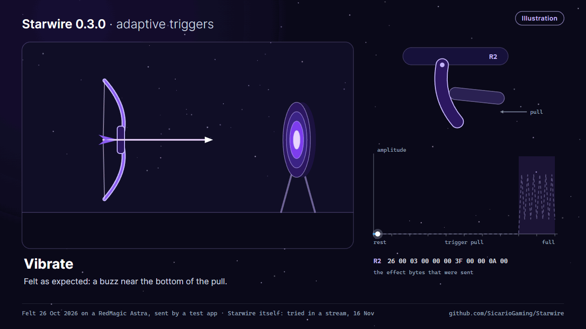
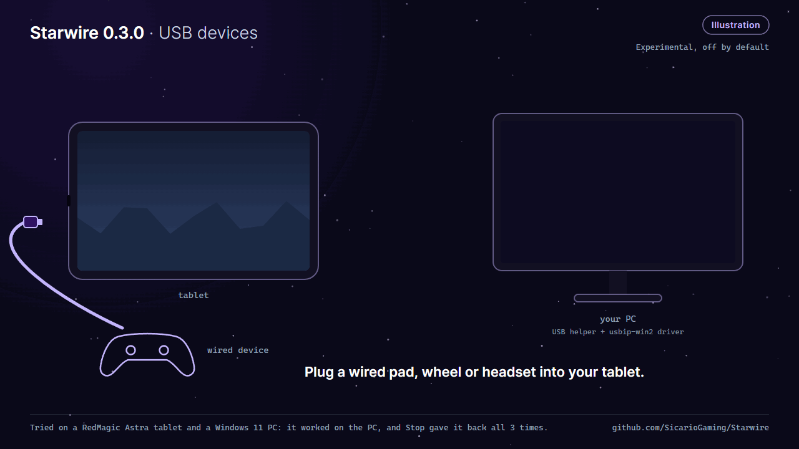
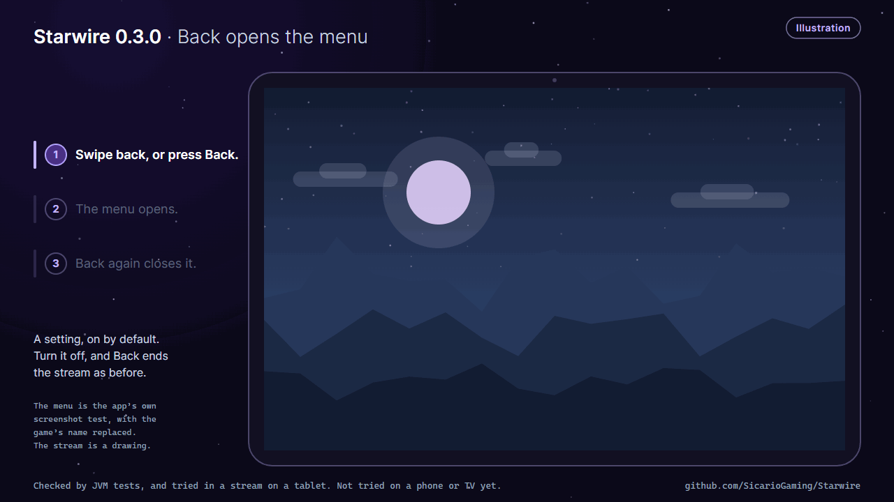

<div align="center">

<h1></h1>

**Stream your PC games to your Android device, with the best of every Moonlight client in one app.**

[](https://github.com/SicarioGaming/Starwire/releases)
[](https://github.com/SicarioGaming/Starwire/releases)
[](LICENSE.txt)

### [⬇ Download Starwire](https://github.com/SicarioGaming/Starwire/releases)


<sub>The whole screen picks up the colour of whatever you select. Games show their own cover art; Desktop and games without art get the Starwire tile, and apps like Steam Big Picture get their own icons.</sub>

</div>

---

## New in 0.3.0

Starwire 0.3.0 is out ([download](https://github.com/SicarioGaming/Starwire/releases/tag/v0.3.0)).
It brings two Experimental features, DualSense adaptive triggers over Bluetooth and USB device
passthrough to your PC, and both are switched off until you turn them on. Back now opens the
stream menu, there is a new Brightness item and a vibration strength setting, and multi-touch mode
now sends real touches to the PC. If you try the Experimental features, a
[GitHub issue](https://github.com/SicarioGaming/Starwire/issues) describing what happened would
help a great deal.

<table>
<tr>
<td width="50%" valign="top">

**🎯 DualSense trigger effects** (Experimental)<br>
A DualSense paired over Bluetooth receives the game's own adaptive trigger effects from a host
that sends them, which Vibepollo does when it emulates a DualSense. For games that send no
effects, there are four presets, and trigger strength has 8 steps. This needs Android 12 or
newer, and you can find it in **Settings → Controllers → DualSense**.

</td>
<td width="50%" valign="top">


<sub>This is an illustration, not a screen capture. The curves are drawn from the bytes of the effects that a separate test app sent to a DualSense on 26 October. Since then, a game's own effects have come through Starwire to the controller during a stream.</sub>

</td>
</tr>
<tr>
<td width="50%" valign="top">


<sub>This is an illustration, not a screen capture. I tried it with my RedMagic Astra tablet and my Windows 11 PC: the device worked on the PC, and selecting it again gave it back to the tablet.</sub>

</td>
<td width="50%" valign="top">

**🔌 USB devices** (Experimental)<br>
Share one wired device plugged into your phone or tablet, such as a controller, a racing wheel or
a headset, with the PC you are streaming from. The device travels through an encrypted connection
tied to the microphone pairing, to the PC's [USB helper](windows/USB-HELPER.md) and usbip-win2's
driver, version 0.9.8.1. This needs a 64-bit ARM device with Android 9 or newer, and you can find
it in **Settings → Controllers**.

</td>
</tr>
<tr>
<td width="50%" valign="top">

**↩ Back opens the stream menu,** and it is on by default. Pressing Back again closes the menu.
The idea comes from Artemis, by way of Artemide.

**Also new:** a controller vibration strength setting, shortcuts for Windows' virtual desktops,
and, from Moonlight X, a Brightness item in the stream menu, a Left edge swipe action setting and
a confirmation before Quit Session closes the game. The setting that was called "Display on the
PC" is now called Virtual display.

</td>
<td width="50%" valign="top">


<sub>This is an illustration. The menu comes from the app's own screenshot test with the game's name replaced, and the stream behind it is a drawing.</sub>

</td>
</tr>
</table>

**All device tests for this release were performed on my RedMagic Astra tablet** (Android 16)
with a DualSense controller, streaming from my Windows 11 PC with Vibepollo, using a test build of
0.3.0 from 27 October. A game's own trigger effects came through to the controller. A USB device
plugged into the tablet appeared on the PC and worked there, and selecting it again gave it back
to the tablet. Back opened the stream menu, the Brightness item and the stream menu itself worked
during a stream, and updating over 0.2.1 kept my PCs, my settings and my microphone pairing.
**Not tried yet:** Starwire's own trigger presets and strength steps on a controller, and
vibration strength, the left edge swipe and the virtual desktop shortcuts during a stream. These
are checked by tests on a computer. The USB setup script has also had less testing than the rest
of this release.

**Updating from 0.2.1:** install the new APK over 0.2.1. On the PC, the microphone receiver has
not changed, so you can keep it as it is. The USB helper is new, and you only need it for USB
devices.

**Two things work differently after the update:**

- **Back opens the stream menu** instead of ending the stream, and pressing Back again closes the
  menu. To leave a stream, use Disconnect or Quit Session in the menu, or turn this off in
  **Settings → In-stream menu → Back opens the menu**.
- **A tap near the left edge of the screen now goes to the game.** The brightness slider is now
  the Brightness item in the stream menu, and a swipe in from the left edge can also open it once
  you choose that in **Settings → In-stream menu → Left edge swipe action**.

<details>
<summary><b>Everything in 0.3.0: what each part needs, every fix, and what was tested</b></summary>

<br>

**Experimental, off by default:**

- **DualSense trigger effects** (Settings → Controllers → DualSense (Experimental) → Trigger
  effects): this needs Android 12 or newer and a DualSense paired over Bluetooth. A controller
  connected by cable is not supported yet. The setting asks for the Nearby devices permission, and
  it uses a hidden Android function, so a future Android update could stop it from working. The
  presets are light resistance, gun click, heavy pedal and buzz, and the Test button sends one
  effect. If a check fails when the controller connects, Starwire falls back to the usual
  controller path, and the status line explains why. Rumble and the light bar work as before.
- **USB devices** (Settings → Controllers → USB devices (Experimental)): once this is on, the
  stream menu has a USB devices page. Select a device there to share it, and select it again,
  unplug it or end the stream to give it back. Controllers, racing wheels, flight sticks and
  audio devices can be shared. Keyboards and mice ask for your confirmation every time. Hubs,
  storage, network adapters, vendor-specific devices (which includes wired Xbox controllers for
  now) and USB 3 devices are refused, and the page shows the reason. On the PC, it needs the
  microphone receiver with this device paired, the [USB helper](windows/USB-HELPER.md)
  (`setup-usb.cmd`, in the Windows zip) and usbip-win2's driver, version 0.9.8.1. Starwire only
  shares devices with a PC on your home network or a private VPN. x86_64 Chromebooks and
  emulators do not get the setting, even ones that can run ARM apps.

<p align="center">

<br>
<sub>This is an illustration of how a game's trigger effects reach the controller, and of which steps were tried.</sub>
</p>

**What's new:**

- **Back opens the stream menu,** and it is on by default. A short press of a TV remote's Back
  button opens it too. The idea comes from Artemis (Yukino Song), by way of Artemide. Thank you to
  u/Glove5751 for asking for it.
- **A Brightness item in the stream menu,** which opens the brightness slider. A controller moves
  the slider in 5% steps. The item is not shown on Android TV. From Moonlight X.
- **A Left edge swipe action setting,** which lets a swipe in from the left edge open the
  brightness slider or the stream menu. It is off by default, so the swipe goes to the game. From
  Moonlight X.
- **Controller vibration strength,** under Controllers, from 0 to 100% of the game's rumble, on
  every controller. Audio haptics on the controller follow the same setting.
- **Shortcuts for Windows' virtual desktops** on the stream menu's Shortcuts page: Win+Ctrl+Left,
  Win+Ctrl+Right and Win+Tab (Task View).
- **Quit Session asks first,** because it closes the game on the PC. From Moonlight X.
- **Virtual display** is the new name of the setting that used to be called "Display on the PC",
  with the choices Host default, On and Off. A choice you already made stays as it was. Thank you
  to u/elenayebenes for asking about it.
- **Google's video decoders, as found on Pixel phones,** are now asked for the most frames they
  can handle at the stream's size. This comes from Moonlight X, which measured about 9 ms per frame
  before the change and about 7.8 ms after it at 120 FPS on a Pixel 10 Pro. I have not tried this
  myself, because I do not have a Pixel.
- The Starwire wordmark on the games screen is a little bigger, and the stats box has rounded
  corners (from Moonlight X).

**Fixes:**

- **Multi-touch mode sent mouse clicks to the PC instead of touches,** and had done so since
  0.1.0. Each finger now reaches the PC as a touch of its own, with up to two at a time.
- **The left part of the stream menu was cut off** when the floating menu button was turned off,
  however the menu was opened. The whole menu now shows. Thank you to SippyCupXIII for reporting
  it on an AYN Odin 2 Portal ([#14](https://github.com/SicarioGaming/Starwire/issues/14)).
- **In touchpad mode, dragging after a long press used the right mouse button,** so a drop ended
  in a right-click. A long press followed by a drag now drags with the left button, and a long
  press without moving is still a right-click. Thank you to kayakyakr for reporting it
  ([#5](https://github.com/SicarioGaming/Starwire/issues/5)).
- A tap near the left edge of the screen goes to the game. Thank you to u/zolidz64 for reporting
  it.
- A button or key that was held down when you opened the stream menu no longer stays pressed on
  the PC.
- Prevent packet loss sent a packet type that Sunshine, Apollo and Vibepollo do not recognise,
  which filled Vibepollo's debug log with about 50 lines a second. It now sends a ping instead. I
  have not yet tried it with Vibepollo logging at its debug level.
- Sunshine, Apollo and Vibepollo no longer receive a message that only GeForce Experience needs.
  Vibepollo used to warn about it every time a stream started. Controller vibration has not been
  tried with this build yet.
- If you change the bitrate twice in a row during a stream, your latest choice now wins. The idea
  comes from Moonlight V+ (qiin2333).
- Starwire no longer tries to show an error or a "please wait" box on a screen that Android has
  already closed. The idea comes from Moonlight V+ (qiin2333).
- With gesture navigation, the last setting now scrolls clear of the gesture bar. From Moonlight X.
- The games screen now picks up a new font size from Android's settings straight away.
- On Android 5.0 and 5.1, the encrypted microphone's code now refuses a damaged packet instead of
  throwing an error. Streams were not affected. The fix has not run on Android 5.0 or 5.1 yet.

**What was tested, and what was not:**

- **On a device:** the device tests are described above, under "All device tests for this
  release". That test build came before the last fixes in this release, which include the fixes
  for #14 and #5 and a fix for unplugging a USB device at the moment sharing starts. Those fixes
  are checked by tests on a computer.
- Before that, on 26 October, a separate test app, not Starwire, sent four trigger effects to the
  same DualSense from the same tablet, and the light bar changed.
- **Not tried on a controller yet:** Starwire's own trigger presets and strength steps.
- **Not run on this build:** the on-device test suite. The USB setup script has also had less
  testing than the rest of this release.
- Everything else new in this release, such as vibration strength, the left edge swipe and the
  virtual desktop shortcuts, is checked by tests on a computer and has not been tried in a stream
  yet.
- 1,030 unit tests for the app pass on a computer (314 in 0.2.1). The USB helper's own tests pass
  on Windows 11, with a fake driver and a test phone over 127.0.0.1.
- The emulator tests on 17 virtual Android devices run on GitHub when the release is published,
  so their results come after the release and appear on the
  [Actions tab](https://github.com/SicarioGaming/Starwire/actions).

**Known issues:**

- The USB devices page shares one device at a time, and wired Xbox controllers are refused for
  now.
- With Flip face buttons turned on, the Quit Session question does not swap A and B the way the
  menu does.
- Once the left edge swipe is turned on, a slow drag to the right from near the left edge opens
  the slider too, which is why the swipe is off by default.

[CHANGELOG.md](CHANGELOG.md) has every change in full, and
[Where every feature comes from](#where-every-feature-comes-from) says who made each part.

</details>

**Next:** profiles are planned for 0.4.0 (thank you to u/kylo_____ben for asking), and a
contributor's Linux microphone receiver is a candidate for the same release. I will also go
through the pull requests that are already open on GitHub.

## Why I made Starwire

I have been exclusively streaming games from my headless PC to client devices for about five
years now. I recently found myself looking for a new Android client, and came upon
[MoreOrLessSoftware](https://github.com/MoreOrLessSoftware)'s
[Moonlight X](https://github.com/MoreOrLessSoftware/moonlight-android), which includes direct
frame pacing and PyroWave support. It had a noticeable impact on my stream quality, even without
using PyroWave (I don't have the connection strength to use it in practice), but I wondered how
the stream could perform if it had the Fast V-Sync, LFR, Async, and Codec options that
Artemis/Artemide has. I also missed some QoL features that the recent Windows forks have adopted
that seem to be lagging in terms of an Android client equivalent.

Back-end development started from
[Moonlight X](https://github.com/MoreOrLessSoftware/moonlight-android)'s video pipeline, adds
the touchscreen tools from [Artemide](https://github.com/derflacco/moonlight-android) and
[Artemis](https://github.com/ClassicOldSong/moonlight-android), and picks up favourite features
from [Moonlight V+](https://github.com/qiin2333/moonlight-vplus),
[Moonlit Artemis](https://github.com/4had45/moonlit-artemis) and
[Moonlight X Turnip](https://github.com/NoCrypt/moonlight-x-turnip). I then gave it a refreshed UI
that draws from some of the trends coming out of Silicon Valley these days. It installs next to
any Moonlight you already have, so you can try it without giving anything up.

## Features

<table>
<tr>
<td width="50%" valign="top">

### 🎨 A look that follows your game
The screens take their colour from the game you've picked. Games without cover art each get
their own take on the Starwire tile, and apps like Steam Big Picture get their own icons. Your
last game is ready to go with one tap, with its stream settings right under its name, and a Quit
button sits beside Resume while it runs.

### 🎮 Everything during a stream, one tap away
Open the menu with Back, the floating button, a three-finger tap or by holding Select on a
controller. Keyboard, full on-screen keyboard, mouse modes, zoom, key shortcuts, monitor
switching, bitrate, brightness, clipboard: it's all in one grid, and works with a controller
too. Anything that turns on and off has a small switch, so you can see what's on at a glance.

### ⚡ Low-latency video options
Moonlight X's Vulkan renderer and PyroWave codec, and the low-latency options from Artemis and
Artemide: Warp Drive, Fast V-Sync and async decoding. I ported them, but I haven't measured how
much each one saves in Starwire yet.

</td>
<td width="50%" valign="top">


<sub>The in-stream menu over Aniimo on my tablet. Stats and the menu button are switched on. Aniimo © Pawprint Studio.</sub>

</td>
</tr>
<tr>
<td width="50%" valign="top">


<sub>Redesigned settings, with the Predicted impact panel on the right.</sub>

</td>
<td width="50%" valign="top">

### 🧭 Feature-packed and intuitive settings
Sections with plain names (Stream, Sound & vibration, Controllers…), and a **Predicted impact**
panel that shows whether your choices lean towards fastest response or smoothest motion, and
which setting is pushing it which way. Tap a setting that came from another fork and a small
line under the panel says where it came from and who made it.

### 🖐 Made for touchscreens
Pinch to zoom anytime, trackpad modes, long-press to right-click, an on-screen keyboard with
every key, and the option to hide the PC's mouse pointer while you play.

### 📳 Feel the bass
Audio haptics turns a game's bass into vibration on your device or controller.

### 🎙 Your microphone on the PC
Talk in game chat or Discord through your device's microphone, **with Vibepollo, Sunshine or
Apollo as they are**: one setup script on the PC, one switch in Starwire, and a code to pair
them once. The audio is encrypted, and only devices you've paired can send it. See
[New in 0.2.0](#new-in-020-your-microphone-on-the-pc-with-any-host) for how it works and how to
set it up.

</td>
</tr>
<tr>
<td width="50%" valign="top">

### 🎯 Adaptive triggers on a DualSense
Experimental, from 0.3.0. A DualSense paired over Bluetooth receives the game's own trigger
effects from a host that sends them, or one of four presets for games that send none, with 8
strength steps. It needs Android 12 or newer. A game's effects have come through to the
controller during a stream on my RedMagic Astra, but I have not yet felt the presets.

</td>
<td width="50%" valign="top">

### 🔌 Your phone's USB devices on the PC
Experimental, from 0.3.0. Plug a wired controller, racing wheel, flight stick or headset into
your phone or tablet and use it on the PC you are streaming from, through an encrypted connection
and a small USB helper on the PC. It shares one device at a time and needs a 64-bit ARM device
with Android 9 or newer. The [USB helper guide](windows/USB-HELPER.md) covers the PC side.

</td>
</tr>
</table>

<p align="center">

<br>
<sub>Aniimo streamed to my RedMagic Astra, with the Lite stats line at the top. Aniimo © Pawprint Studio.</sub>
</p>

## Get started

1. **Set up your PC.** I use [Vibepollo](https://github.com/Nonary/Vibepollo), and it's the only
   host I test with; it supports every feature. [Apollo](https://github.com/ClassicOldSong/Apollo)
   and [Sunshine](https://github.com/LizardByte/Sunshine) should work too, since Vibepollo is built
   on them, but I haven't tried them myself. Some extras need Vibepollo or an Apollo-based host,
   and the feature tables below mark them. On Sunshine that means no clipboard sharing, PC
   commands, Virtual Display, changing the bitrate mid-stream or hiding the PC cursor.
2. **Install Starwire.** Download the latest `Starwire-…apk` from the
   [Releases page](https://github.com/SicarioGaming/Starwire/releases) and open it.
3. **Pair.** Tap your PC, then type the PIN Starwire shows into your host's PIN page (usually
   `https://localhost:47990`). You only do this once.
4. **Play.** Tap a game, then **Play**.

Android 5.0+. PyroWave, the experimental custom Turnip driver option and USB devices need a
64-bit ARM device, and USB devices needs Android 9 or newer. DualSense trigger effects need
Android 12 or newer. Updates from the Releases page install over the top and keep your settings,
and [Obtainium](https://github.com/ImranR98/Obtainium) can keep it updated for you.

## New in 0.2.0: your microphone on the PC, with any host

Mic passthrough was a highly requested feature after the 0.1.0 launch, and one of the last things
keeping a Moonlight stream from feeling like you're really sitting at your PC. Parsec has had it
for years, but with Moonlight it meant switching your PC to a host build that has a mic channel,
like logabell's Apollo fork. Most of us don't want to swap host programs, and I wasn't keen on
giving up a Vibepollo setup that already works flawlessly.

So this works without touching the host: Starwire sends your mic straight to the PC as VBAN
(VB-Audio's network audio format), a small receiver plays it into VB-Cable, a free virtual
microphone, and Discord or the game picks it up as a normal mic. Vibepollo, Sunshine and Apollo
stay exactly as they are, and the mic starts and stops with the stream, with no separate mic app
like WO Mic or AudioRelay to open on your Android device each time.

<p align="center">

<br>
<sub>This is 0.2.0's path. From 0.2.1 each VBAN packet travels encrypted inside Starwire's SWMC format, and the receiver only plays audio from devices you've paired, through WASAPI. How it works, below, has the details.</sub>
</p>

1. On the PC, download **Starwire-Microphone-for-Windows.zip** from the
   [latest release](https://github.com/SicarioGaming/Starwire/releases/latest), unzip it and
   double-click `setup-microphone.cmd`. It needs nothing installed first: it builds the receiver
   with the compiler that comes with Windows, downloads VB-Cable from VB-Audio if you don't have it
   (and checks VB-Audio signed it), lets the receiver through the firewall for local and private VPN
   addresses only, starts it when you sign in and checks the virtual mic works. The receiver has no window, just an icon by
   the clock. [Full guide](windows/README.md).
2. In Discord or the game, choose **CABLE Output** as the microphone.
3. In Starwire: **Settings → Sound & vibration → Send my microphone**.
4. Pair them, once: on the PC, right-click the receiver's icon by the clock, choose **Pair a
   device...**, then **Show the code**. In Starwire, tap **Pair with the PC** under Send my
   microphone, pick the PC and type the code.

<p align="center">

<br>
<sub>All of this is automatic: one double-click runs the PowerShell setup, which builds and starts the receiver, installs VB-Cable if it's missing, adds the firewall rule and checks the virtual mic. This is it finishing on my PC.</sub>
</p>

The receiver has no window: right-click its icon by the clock to pair a device, see the paired
devices, check the virtual mic, play a test tone for Discord's mic test or quit (or end it in Task
Manager). Measured with 0.2.0, before the encryption, on my tablet over Wi-Fi: 16,880 packets in
90 seconds with none lost, no gaps in the receiver's buffer (usually 30 to 50 ms queued) and about
0.85 Mbps of upload. The raw data and a script that recomputes every number are in
[docs/measurements](docs/measurements/2026-10-22-mic/).

**Please read this before you use it.** From 0.2.1 the microphone is encrypted, and the receiver
only plays audio from devices you've paired with that PC. Being on the same network is no longer
enough to listen to it or to send sound into your PC's virtual mic, and the encryption doesn't
need Tailscale or a VPN like it. Three things to know:

- **Updating from 0.2.0 needs both sides:** the app and the PC setup, then pairing once. A 0.2.0
  receiver won't understand the new app, and the new receiver refuses 0.2.0's unencrypted audio.
- **Don't show the pairing code while your screen is shared.** Anyone who sees it before you've
  typed it could pair instead of you.
- **"Not encrypted"**, the option for Voicemeeter and other VBAN apps, sends plain VBAN, like 0.2.0
  did. Anyone on the same network can listen to that or send sound into it, so use it only on a
  network you trust. Starwire's receiver only plays plain VBAN if you set it up with
  `-AllowUnencrypted`, and then anyone on the network can send sound into it too.

[SECURITY.md](SECURITY.md) says what the encryption protects against and what it doesn't. If your
PC runs [logabell's Apollo build](https://github.com/logabell/apollo-microphone/releases), you can
send the mic over the stream itself instead.

**Encrypted, and only from paired devices.** You pair each Android device with the PC once: the
receiver shows a 16-character code and you type it into Starwire (**Settings → Sound & vibration
→ Send my microphone → Pair with the PC**). The code authenticates a key exchange, so the device
and the PC end up with a key nobody else on the network has. Each stream then gets its own
AES-256-GCM key, every packet is encrypted and authenticated with a counter that only goes up,
and the receiver refuses anything it can't check: devices it hasn't paired, recorded packets sent
again, and plain VBAN.

What's tested: the app and the receiver give the same bytes for a shared set of test vectors, the
app's pairing and sender work against the receiver on one PC's loopback (every packet played in
order, a replayed, a late, two forged and one plain VBAN packet refused), and the app's side runs
on my tablet, where encrypting took about 6.5 microseconds per packet in a benchmark. On 23 Oct I
streamed from my tablet to my PC over Wi-Fi with a receiver that only takes encrypted audio, and
the sound came through only while the stream ran. I didn't count dropouts in that test. The format
is in [docs/dev/mic-protocol.md](docs/dev/mic-protocol.md).

<details>
<summary><b>How it works and what I measured</b></summary>

<br>

On the Android device, Starwire records with `AudioRecord` using the `VOICE_COMMUNICATION` source and turns
on the platform echo canceller and noise suppressor where the device has them. It reads 20 ms at a
time and makes 48 kHz 16-bit mono PCM into VBAN packets: a 28-byte header and 256 samples per
packet, 187.5 packets a second. Each one is encrypted inside Starwire's SWMC format (584 bytes
with its header and tag) and sent over UDP (port 6980 by default); the "Not encrypted" option sends
the plain VBAN packets instead. It sends to the PC you're streaming from, so there's no address to
type in, and it doesn't ask the host for a mic channel.

On the PC, `StarwireMicReceiver` (two C# files, built on your PC from the source in the zip)
plays a packet only if it comes from a paired device, checks out under that stream's key and has
a higher counter than any it has played. As an extra layer it still only takes packets from
local-network or private VPN addresses (a filter, not a security check). It plays into CABLE Input
through WASAPI, in 2.7 ms steps on VB-Cable, and uses waveOut's 10 ms blocks (as 0.2.0 did) if
WASAPI doesn't work. Playback starts once 40 ms is queued and never falls more than 120 ms behind.
The device's and the PC's clocks drift apart (about 60 ppm in my test), so the receiver notes how
low the buffer gets in the first 2 seconds, and when it then stays 10 ms or more above that for 2
seconds, it skips 10 ms to keep the delay down (with waveOut, when it stays above 60 ms for 2
seconds).

<p align="center">

<br>

<br>
<sub>The packet, the receiver's rules and the chart are from 0.2.0, before the encryption. In 0.2.1 this VBAN packet travels encrypted inside SWMC. Two notes on the chart are rounded. Checked packet by packet, the network's own spread was 6.4 ms at p99 and 21.6 ms at worst, and the buffer dipped to 20 ms a few times but never ran dry. <a href="docs/measurements/2026-10-22-mic/">The data and the script</a> give every exact number.</sub>
</p>

- With 0.2.0's waveOut playback, on the PC alone, a packet took about 107 to 119 ms to be heard
  on CABLE Output: 40 ms of buffer, the rest Windows' audio path. With WASAPI in 0.2.1, in my
  tests on the PC with recorded Wi-Fi timing, the median delay dropped from about 114 to 98 ms
  (about 7 ms less with a steady clock). I haven't measured the Android side yet.
- Echo cancelling is whatever the device provides, and some Android devices only apply it to
  calls; headphones get around that.
- The setup and receiver are Windows only for now. On Linux, PipeWire's VBAN receive module should
  take the "Not encrypted" option's stream (Stream1, UDP 6980), but I haven't tried it.
- The receiver starts when you sign in, not as a service, so it doesn't run on a PC sitting at the
  sign-in screen.

</details>

## Development

I made Starwire as a vibecoding exercise after experiencing the wonderful software that is
Vibepollo. I decided what the app should do and how it should look, and
[Claude Code](https://claude.com/claude-code) wrote the code. I also
used [REA](https://github.com/morluto/rea) by morluto to look inside the other apps and see how
their features work. I test on my RedMagic Astra (Snapdragon 8 Elite, Android 16) with a GameSir
G8+ and a DualSense, streaming from Vibepollo, and on my Galaxy Z Fold 6. The on-device tests in
`app/src/androidTest` run on the tablet. Some things haven't been tried yet: the custom
Turnip driver option with a real Turnip driver, and hosts other than Vibepollo.
[CONTRIBUTING.md](CONTRIBUTING.md) says how to build Starwire and run the tests.

### What's in this repo

| Folder or file | What it is |
| --- | --- |
| [`app/`](app) | The Starwire Android app, with its tests in `app/src/test` and `app/src/androidTest` |
| [`usbip-backend/`](usbip-backend) | The USB exporter that USB devices uses, from Moonlight V+, built on usbipdcpp and libusb ([its README](usbip-backend/README.md)) |
| [`windows/`](windows) | The microphone receiver, the USB helper and their setup for the Windows PC |
| [`docs/`](docs) | Screenshots, the [roadmap](docs/ROADMAP.md), [where the prebuilt libraries come from](docs/PROVENANCE.md), the mic measurements and maintainer notes |
| [`.github/`](.github) | The workflows that build, test and release Starwire, the issue forms, the release notes and the maintainer's scripts |
| [`CHANGELOG.md`](CHANGELOG.md) | What changed in each version |
| [`CONTRIBUTING.md`](CONTRIBUTING.md) | How to build, test and send a change, and the rules for commits, branches and version numbers |
| [`SECURITY.md`](SECURITY.md) | How to report a security problem privately |
| [`AGENTS.md`](AGENTS.md), [`CLAUDE.md`](CLAUDE.md) | The rules for anyone changing Starwire, people or coding agents |
| [`LICENSE.txt`](LICENSE.txt) | The GPL-3.0 licence |
| `.gitmodules` | Links moonlight-common-c, the streaming protocol library, from [Starwire's copy](https://github.com/SicarioGaming/moonlight-common-c) |
| `build.gradle`, `settings.gradle`, `gradle.properties`, `gradle/`, `gradlew`, `gradlew.bat` | The Gradle build settings and the Gradle wrapper |
| `.gitignore`, `.gitattributes` | Files kept out of the repo, and the shell scripts Git keeps with Unix line endings |

## Changelog

The full list of changes in every version, and what's coming next, is in [CHANGELOG.md](CHANGELOG.md).

<details>
<summary><b>Earlier updates</b></summary>

### Update (23 Oct)

Hey everyone - thank you so much for giving Starwire a chance, and for all of the meaningful feedback I've received thus far. I may never beat the "AI/Vibecoded Slop" allegations fully, but I promise to keep trying with my chin up haha.

After [u/rambo3349](https://www.reddit.com/r/MoonlightStreaming/comments/1xd12x5/starwire_020_mic_passthrough_wo_needing_to_modify/19rigium2zrt0/) reviewed Starwire's code and GitHub repo, I made a bunch of changes to hopefully resolve some of those issues. If there are any further issues with the code or Github repo, I will prepare a smaller release to address them (ex. 0.2.2) as opposed to making you guys wait for the next major release (0.3.0, which I am targeting for early next week).

In the longer-term pipeline (0.4.0), I noticed a lot of users are connecting from an Ayn Thor or similar DS device. I'm actually super jealous, my Thor should arrive in the next month and on that front I'm wondering what you guys would like to see in terms of "DS features" in future Starwire releases.

Aside from that, here are the release notes for 0.2.1, which is out now ([download](https://github.com/SicarioGaming/Starwire/releases/tag/v0.2.1)):

#### Release notes for 0.2.1

**Following u/rambo3349's code review (already live on GitHub):**

- **Real commit history:** every commit now has its own description, and the repo shares history with Moonlight X again, so upstream updates can be merged properly.
- **Prebuilt libraries:** every one is traced back to its source and rebuilt byte for byte by GitHub ([PROVENANCE.md](docs/PROVENANCE.md)).
- **Clearer about what's experimental:** the custom Turnip driver is now described as an experimental option, not listed with the speed features.
- **Mic measurements:** the 0.2.0 numbers are published with the raw data and a script that recomputes them ([here](docs/measurements/2026-10-22-mic/)), with two rounded numbers corrected.
- **Security and contributing:** a [SECURITY.md](SECURITY.md) with private vulnerability reporting, and a [CONTRIBUTING.md](CONTRIBUTING.md).
- **Checksums** are on the release pages, so you can check your download.

**What's new in 0.2.1:**

- **Encrypted microphone:** the mic is now encrypted, and only devices you've paired can send audio to your PC. Being on the same network is no longer enough, and encryption no longer requires Tailscale or a similar VPN.
- **Less mic delay:** the PC side plays through a faster Windows audio path. In my tests the median delay dropped from about 114 to 98 ms, with far fewer dropouts.
- **The mic setup window** fits small screens, like a 1280x720 stream.
- **Custom resolutions and frame rates,** in the main settings and per game. These come from Moonlight X, credited to them.
- **An about page** with credits and the full open-source licences.
- **The floating menu button stays where you put it,** for each orientation.
- **The custom driver option** is marked experimental, with a plain warning before you turn it on.
- Various other small cleanups to the Github repo and changes to wording for transparency.

**Fixes**

- The PC's cursor comes back if Starwire is closed or crashes while it's hidden, and there's a "Fix PC cursor" button in the stream menu.
- No more "PC not paired" flicker on the games screen.
- No more crash on RedMagic devices when the games screen resizes.
- No more crashes from some unusual host replies, or on the resume button on Android 5 and 6.
- A rare video mix-up with async decoding after a hiccup is fixed.
- On Android 5 to 7, the background animations now stop when animations are turned off (saves battery).
- The in-stream menu and the games screen fit small screens better.

**Testing and Development**

- 314 unit tests (from none), 32 of them screenshot tests, and 138 on-device tests.
- The same tests also run on 5 virtual devices, including a Fold shape folded, half-open and unfolded. (Thank you to u/MickeyBronson)
- Checks run automatically on every change.

**Known issues**

- Right-to-left languages (Hebrew, Persian) show translated text, but the layout doesn't mirror yet.
- On very narrow screens, the Quit and Disconnect buttons can cut their labels short.
- The custom Turnip driver option still hasn't been tried with a real Turnip driver.

Thank you all for your continued trust and engagement. Please keep an eye out for announcements re: 0.3.0. Cheers!

**2026/10/22:** [Version 0.2.0](https://github.com/SicarioGaming/Starwire/releases/tag/v0.2.0)
sends your microphone to the PC with any host (Vibepollo, Sunshine, Apollo), through a small
receiver and VB-Cable that one setup script installs. It also fits more Android devices
(settings were blank on narrow screens like a Galaxy Z Fold's cover screen, and the game screen's
header now scrolls away), adds a short "Impact:" line to the settings that affect latency and
performance, tidies the stream menu with on/off switches and a smaller floating button that
also closes it, puts a Quit button beside Resume, gives each game without cover art its own
Starwire tile, and fixes a crash when tapping a running Desktop tile. The release page has the full
list.

**2026/10/22:** [Version 0.1.2](https://github.com/SicarioGaming/Starwire/releases/tag/v0.1.2)
has been released, and fixes an error that caused the client to crash upon loading the list of
apps. To update, download the new APK and open it on your device. You will receive a prompt to
update the existing app, which will retain existing settings. Obtainium users should receive the
update automatically.

</details>

---

## Where every feature comes from

Each feature below says where it came from:

- **Ported from *project* (*author*)**: that project's code, brought into Starwire and adapted.
- **Idea from *project* (*author*)**: inspired by that project, but written new for Starwire.
- **New in Starwire**: written for Starwire.

Where a feature started in an older version and was carried forward (for example Artemis →
Artemide), both are named. Features marked **(Apollo / Vibepollo)** need an Apollo-based host.

<details>
<summary><b>Cover Glow, the new design</b></summary>

*New in Starwire.*

- **Game screen:** the selected game shown large with its cover, name, Play/Resume and its
  stream settings as small tags. It starts on the game running on the PC, otherwise the one you
  played last. While a game runs, Quit sits beside Resume. The top scrolls away with your games,
  leaving a slim bar with the selected game and its Play button.
- **Colours from the cover:** the background and glow take the game's cover colour and fade
  between games. White text stays readable on every colour.
- **Icons for apps without cover art:** Desktop, Steam Big Picture, Playnite and similar apps get
  an icon tile in their own colour instead of the host's plain default image. **Settings → App →
  App covers** can also use icons for every app, or only ever the PC's covers.
- **Starwire tiles for games without cover art:** each game gets its own take on the tile,
  worked out from its name (colour, ring angle, moon, glow and stars), so a row of them doesn't
  look the same.
- **A little flair:** the Starwire wordmark and the ring around the selected game slowly flow
  through a rainbow, and a starfield with a few twinkling stars sits behind the screens. Covers
  have soft rounded corners, arrive one after another and give a little when you press them, and
  the selected cover floats gently. The looping animations pause while you stream.
- **PC list:** frosted cards and a frosted quick-settings bar.
- **Settings:** section buttons that jump to each section and follow you as you scroll, plain
  section names (in English), and the Predicted impact panel on wide screens. It compares the
  choices rather than measuring them.
- **In-stream menu:** a side sheet in the game's colour with a grid of tools, usable with a
  controller.

</details>

<details>
<summary><b>In-stream menu</b></summary>

The menu itself, its quick actions and custom commands come from Moonlight X
(MoreOrLessSoftware). Starwire adds:

| Feature | Source |
| --- | --- |
| Floating menu button (tap to open, drag to move) | Ported from Artemis (Yukino Song / ClassicOldSong), via Artemide |
| A smaller floating button that stays see-through until you touch it, and closes the menu too | New in Starwire, on the Artemis button |
| The floating button stays where you dragged it, with a spot for landscape and one for portrait | New in Starwire |
| From 0.3.0: Back opens the menu instead of ending the stream, and Back again closes it. It's on by default, with a switch in Settings → In-stream menu. A short press of a TV remote's Back opens the menu too. Tested in JVM tests and tried in a stream on a tablet, not yet on a phone or a TV | Idea from Artemis (Yukino Song / ClassicOldSong), via Artemide. The TV remote part is new in Starwire, on Moonlight X's remote handling |
| On/off switches on the items that toggle something, and the menu stays open when you tap them | New in Starwire |
| The menu header shows the game's cover art, or a Starwire tile for Desktop and games without art | New in Starwire |
| Shortcuts page: Esc, F11, Alt+F4, Alt+Enter, Ctrl+V, Win, Win+D, Win+G, Ctrl+Alt+Tab, Shift+Tab, Win+Shift+Left, Ctrl+Alt+Shift+F1/F12, Win+Alt+B | Ported from Axixi2233's Moonlight fork (axi), via Artemis and Artemide |
| From 0.3.0: Win+Ctrl+Left and Win+Ctrl+Right (previous and next desktop) side by side, then Win+Tab (Task View), on the Shortcuts page. Checked by tests, not yet tried in a stream | New in Starwire |
| Custom shortcuts imported from a file (same JSON format) | Format from Axixi2233's fork (axi) and Artemis (Yukino Song); importer written new for Starwire |
| Task Manager (Ctrl+Shift+Esc) | Ported from Artemis (Yukino Song), via Artemide |
| Rotate screen, Pan/Zoom mode (pinch to zoom, drag to pan, double-tap to reset) | Ported from Artemis (Yukino Song), via Artemide |
| Touch mode picker (multi-touch, direct touch, natural and gaming trackpad, disabled, swapped clicks) | Ported from Artemis (Yukino Song), via Artemide |
| Trackpad sensitivity, toggled from the menu | Ported from Artemis (Yukino Song) and Axixi2233's fork, via Artemide |
| Send / get clipboard **(Apollo / Vibepollo)** | Ported from Artemis (Yukino Song), via Artemide |
| PC commands (run the host's server commands) **(Apollo / Vibepollo)** | Ported from Artemis (Yukino Song), via Artemide |
| On-screen full keyboard (82 keys, sticky Ctrl/Alt/Shift/Win, vibration) | Ported from Axixi2233's fork (axi) and Artemis (Yukino Song), via Artemide |
| On-screen controller toggle | Ported from Artemis (Yukino Song), via Artemide |
| Monitor switcher (Monitor 1–6, using the host's Ctrl+Alt+Shift+F1… shortcuts) | Idea from Moonlit Artemis (Mohammad Forhad / 4had45) |
| Change bitrate mid-stream **(Vibepollo)** | Idea from Moonlight V+ (qiin2333) |
| From 0.3.0: a Brightness item that opens the brightness slider, left out on Android TV. A controller moves it in 5% steps. A swipe in from the left edge of the screen can open the slider or the menu too. It's off by default: turn it on in Settings, In-stream menu, Left edge swipe action. The swipe starts within 80 dp of the edge (about 1.3 cm) and moves 60 dp to the right (about 1 cm) within half a second, so a slow drag from near the edge counts too, and the drag goes to the game until then. A tap at the edge goes to the game. The slider stays up until you change it, then hides 2 seconds after your last change. Checked by tests. The Brightness item was tried in a stream on a tablet; the swipe hasn't been tried in a stream yet | Ported from Moonlight X (MoreOrLessSoftware), as a tile in Starwire's menu and a setting under In-stream menu |
| From 0.3.0: Quit Session asks before it closes the game on the PC. Yes quits, and No or Back keeps streaming. Checked by tests with touch and a controller's A and B buttons, not yet tried in a stream | Ported from Moonlight X (MoreOrLessSoftware) |

</details>

<details>
<summary><b>Streaming and video</b></summary>

| Feature | Source |
| --- | --- |
| Vulkan renderer with host frame timing, PyroWave codec | From Moonlight X (MoreOrLessSoftware) |
| From 0.2.1: custom resolutions and frame rates. A Custom button in the resolution and frame rate lists takes any size up to 7680x4320 and any frame rate, in Settings and per game. It replaces Unlock FPS, and a saved value the device doesn't list is kept instead of being reset. Not yet tried in a stream with Starwire | From Moonlight X (MoreOrLessSoftware) |
| Custom Vulkan driver (Turnip) for PyroWave: experimental and off by default, and not yet tried with a real Turnip driver | Ported from Moonlight X Turnip (ncpt / NoCrypt), uses libadrenotools (Billy Laws / bylaws). The libadrenotools libraries in the repo were built from the upstream commit in `SOURCE`, not copied from the fork. Starwire refuses files that aren't 64-bit ARM libraries, and goes back to the system driver when one can't load or can't run PyroWave (tested with a broken file, not a real driver) |
| Warp Drive / Warp 2 frame pacing (2x / 4x FPS from the PC, newest frame shown) | Ported from Artemis (Yukino Song), via Artemide |
| Fast V-Sync (Artemide's Nano Pacer) | Ported from Artemide (derflacco) |
| V-Sync (one setting: Off, V-Sync, Fast V-Sync) | V-Sync for the direct renderer is new in Starwire; Fast V-Sync as above |
| Sync: LFR | Ported from Artemide (derflacco) |
| Async decode and Async: LFR | Ported from Artemide (derflacco) |
| Ultra Low Latency: MediaTek's own ultra-low-latency mode follows the setting, and low latency is set again after the decoder starts | Ported from Artemide (derflacco). The base option and its Snapdragon/Exynos/Amlogic flags are from Moonlight X (MoreOrLessSoftware) and Artemis |
| Virtual Display: the "Virtual display" setting (in Settings under PC, and per game) and "Start in Virtual/Primary Display" when long-pressing a game **(Apollo / Vibepollo)** | Ported from Artemis (Yukino Song), via Artemide |
| Prevent Packet Loss (keeps Wi-Fi awake during streams) | Option from Artemis (Yukino Song), via Artemide; rewritten for Starwire as a small keep-alive ping |
| Lite performance overlay (one compact line: data rate, ping, decode time, dropped frames, FPS) | Ported from Axixi2233's fork (axi), via Artemis and Artemide; the plain wording is new in Starwire |
| 1% low FPS in the stats | Idea from Moonlight V+ (qiin2333) and Moonlight X Turnip (NoCrypt) |
| From 0.3.0: Google's video decoders, as on Pixel phones, are asked for the most frames they can handle at the stream's size. Moonlight X measured about 9 ms a frame before and 7.8 ms after at 120 FPS on a Pixel 10 Pro. Not tried with Starwire: we don't have a Pixel | Ported from Moonlight X (MoreOrLessSoftware) |
| From 0.3.0: rounded corners on the stats box | Ported from Moonlight X (MoreOrLessSoftware) |

</details>

<details>
<summary><b>Input and feel</b></summary>

| Feature | Source |
| --- | --- |
| Pinch to zoom anytime, outside Pan/Zoom mode | Idea from Moonlit Artemis (Mohammad Forhad / 4had45); uses Artemis's pan/zoom code (Yukino Song) |
| Automatic clipboard sync (send yours when the stream starts, copy the PC's when you leave) **(Apollo / Vibepollo)** | Ported from Artemis (Yukino Song), via Artemide |
| Audio haptics: the game's bass becomes vibration on the device and/or the controller | Idea from Moonlight V+ (qiin2333); written new for Starwire |
| From 0.3.0: controller vibration strength, 0 to 100% of the game's rumble on every controller. Audio haptics on the controller follows it too. Not yet tried on a device | New in Starwire |
| Hide PC cursor (never / while touching / always) **(Vibepollo)** | New in Starwire |
| Long-press to right-click in gaming trackpad mode | New in Starwire |
| Settings, the game screen and the stream menu fit more Android devices, down to narrow screens like a Galaxy Z Fold's cover screen; the game screen's header scrolls away with the covers | New in Starwire |
| An "Impact:" line under settings that change latency, smoothness, picture quality or battery | New in Starwire |
| From 0.3.0: with gesture navigation, the last setting scrolls clear of the gesture bar. Checked by a test, not yet tried on a device | Ported from Moonlight X (MoreOrLessSoftware) |
| On a foldable's inner screen, the stream follows the device instead of forcing landscape | Idea from [Moonlight Fold](https://github.com/sblocktechnologies/moonlight-fold) (sblocktechnologies) and [moonlight-android#1613](https://github.com/moonlight-stream/moonlight-android/pull/1613) |
| Send your microphone to the PC with any host: a VBAN stream to Starwire's receiver on the PC, which plays it into VB-Cable. Encrypted from 0.2.1, and only from devices you've paired with the PC; a "Not encrypted" option stays for Voicemeeter and other VBAN apps ([see above](#new-in-020-your-microphone-on-the-pc-with-any-host)). The receiver has no window, just an icon by the clock with pairing, a mic check and a test tone | New in Starwire, with its Windows receiver and setup script; VBAN is VB-Audio's network audio format |
| Or send it over the stream itself, with a choice of microphone **(needs [logabell's Apollo build](https://github.com/logabell/apollo-microphone/releases) on the PC)** | Ported from logabell's Artemis and moonlight-common-c microphone changes ([Artemis PR #537](https://github.com/ClassicOldSong/moonlight-android/pull/537)); echo-cancelled capture is new in Starwire |
| Per-game settings for the new options (codec, V-Sync, LFR, async decode, display, touch mode, cursor, audio haptics, and from 0.2.1 the jitter buffer) | Extends Moonlight X's per-app settings (MoreOrLessSoftware); the per-game jitter buffer is from Moonlight X too |
| From 0.3.0: DualSense trigger effects over Bluetooth (Experimental, Android 12 and newer): the game's own adaptive trigger effects, four presets for games that send none, a strength setting, a status line and a Test button. In a stream on a RedMagic Astra (Android 16), a game's own effects came through Starwire to a DualSense. The presets and strength steps haven't been felt on a pad yet. Before that, a separate test app changed the same pad's light bar and sent it four trigger effects | Bluetooth route and pad matching ported from Moonlight V+ (qiin2333); the code that passes the host's effects to Java is from Nightjar (Ramazan Kara); report layout written from Linux's hid-playstation driver, SDL and Nielk1's trigger notes; uses HiddenApiBypass (LSPosed). The rest is new in Starwire |
| USB devices (Experimental), the phone's side: a setting under Controllers adds a "USB devices" page to the stream menu, which shares a wired device with the PC through the USB/IP exporter inside the app and an encrypted tunnel to the PC's USB helper, after the device rules decide what may be shared (one device at a time, Android 9 or later on 64-bit ARM). Tested on a computer against a fake helper on 127.0.0.1, and tried once on a RedMagic Astra (Android 16) with a Windows 11 PC and the real helper: a device plugged into the tablet showed up on the PC and worked there, and Stop gave it back | The exporter is ported from Moonlight V+'s usbip-backend (qiin2333), after yunsmall's Android-Usbipdcpp, and built on usbipdcpp (yunsmall, LGPL-3.0) and libusb; the stream menu's page, the tunnel, the device rules and one-device sharing are new in Starwire |
| USB devices, the PC's side: Starwire's USB helper for Windows (`setup-usb.cmd`, in the Windows zip) takes the device over the encrypted tunnel from a phone paired with the PC's microphone receiver, checks it against the same device rules and attaches it with usbip-win2's driver, version 0.9.8.1. Off until you turn it on in its menu, and each phone needs its own tick. Its own tests pass on Windows 11 with a fake driver and a test phone; the setup's install hasn't been tried yet ([USB-HELPER.md](windows/USB-HELPER.md)) | New in Starwire; uses usbip-win2's driver, installed separately |

</details>

<details>
<summary><b>Kept from Moonlight X, and not included</b></summary>

**Kept from Moonlight X** (all by MoreOrLessSoftware): Quick Launch apps, per-app settings,
brightness slider, bitrate and stats overrides, Force HDR, the in-stream overlay menu with custom
commands, the improved stats overlay, and Ultra Low Latency. See the
[Moonlight X README](https://github.com/MoreOrLessSoftware/moonlight-android).

**Not included:** Artemide's customisable on-screen key buttons, and its other MediaTek
queue/preload values and NVIDIA Tegra and legacy Qualcomm decoder extras.

</details>

## Credits

Anything that came from another Moonlight version is that author's work. Please go give their
repos a star:

| Project | Author | Used for |
| --- | --- | --- |
| [Moonlight Android](https://github.com/moonlight-stream/moonlight-android) | Cameron Gutman and contributors | The original client everything here is built on |
| [Moonlight X](https://github.com/MoreOrLessSoftware/moonlight-android) | MoreOrLessSoftware | The base of Starwire: Vulkan renderer, PyroWave, overlay menu, per-app settings, Quick Launch, custom resolutions and frame rates. From 0.3.0: the Brightness item, the left edge swipe, Quit Session's question, what Starwire asks of Google's decoders, the rounded stats box and the room for the gesture bar |
| [Artemis](https://github.com/ClassicOldSong/moonlight-android) | Yukino Song (ClassicOldSong) | Pan/zoom, touch modes, clipboard, server commands, Virtual Display, Warp pacing, floating button, the idea for Back opening the menu, and more (via Artemide) |
| [Artemide](https://github.com/derflacco/moonlight-android) | derflacco | Nano Pacer / Fast V-Sync, Sync and Async LFR, async decode, MediaTek low-latency work, and the version of all the Artemis features above that Starwire ported |
| [Moonlight (Axixi2233 fork)](https://github.com/Axixi2233/moonlight-android) | Axixi2233 | Full keyboard, shortcuts list, Lite overlay, shortcut file format (via Artemis) |
| [Moonlight X Turnip](https://github.com/NoCrypt/moonlight-x-turnip) | ncpt (NoCrypt) | Custom Turnip Vulkan driver for PyroWave |
| [Moonlight V+](https://github.com/qiin2333/moonlight-vplus) | qiin2333 | The USB exporter that USB sharing is built on (usbip-backend). Ideas: bitrate mid-stream and one change at a time, audio haptics, 1% lows, and skipping a dialog whose screen has closed. Ported: how the DualSense trigger effects reach the pad over Bluetooth (the four send calls, finding the pad) |
| [Moonlit Artemis](https://github.com/4had45/moonlit-artemis) | Mohammad Forhad (4had45) | Ideas: monitor switcher, pinch to zoom anytime |
| [Moonlight Fold](https://github.com/sblocktechnologies/moonlight-fold) | sblocktechnologies | Idea: letting the stream follow a foldable's inner screen |
| [Nightjar](https://github.com/RamazanKara/nightjar) | Ramazan Kara | Ported: passing the host's DualSense trigger effects from moonlight-common-c to Java |
| [Apollo microphone](https://github.com/logabell/apollo-microphone) | logabell | The in-stream microphone: the Android capture, the moonlight-common-c changes, and the Apollo build that receives it |
| [VBAN and VB-Cable](https://vb-audio.com/Cable/) | VB-Audio (Vincent Burel) | VBAN, the network audio format Starwire's microphone uses, and VB-Cable, the virtual microphone the receiver plays into (donationware) |
| [PyroWave](https://github.com/Themaister/pyrowave) | Hans-Kristian Arntzen (Themaister) | The PyroWave codec (MIT) |
| [libadrenotools](https://github.com/bylaws/libadrenotools) | Billy Laws (bylaws) | Loading a custom Adreno Vulkan driver (BSD-2-Clause) |
| [usbipdcpp](https://github.com/yunsmall/usbipdcpp) | yunsmall | The USB/IP server inside the app that USB sharing uses (LGPL-3.0). This product uses usbipdcpp (https://github.com/yunsmall/usbipdcpp), licensed under LGPLv3. |
| [Vibepollo](https://github.com/Nonary/Vibepollo) | Chase Payne (Nonary) | The host Starwire is developed with (fork of Apollo) |
| [Apollo](https://github.com/ClassicOldSong/Apollo) / [Sunshine](https://github.com/LizardByte/Sunshine) | ClassicOldSong / LizardByte | The hosts Vibepollo is built on |
| [Claude Code](https://claude.com/claude-code) | Anthropic | Writing the Starwire code, ports, redesign and tests |
| [REA](https://github.com/morluto/rea) | morluto | Reverse-engineering and analysis (MIT) |

The DualSense and USB parts also rely on these:

- [HiddenApiBypass](https://github.com/LSPosed/AndroidHiddenApiBypass) by LSPosed (Apache-2.0)
  reaches the hidden Android call that sends the DualSense's trigger effects.
- [Nielk1's trigger effect notes](https://gist.github.com/Nielk1/6d54cc2c00d2201ccb8c2720ad7538db)
  (MIT) give the layout of the trigger effects, and which modes Starwire passes on to the pad.
- Linux's [hid-playstation](https://github.com/torvalds/linux/blob/master/drivers/hid/hid-playstation.c)
  driver (Sony Interactive Entertainment) and [SDL](https://github.com/libsdl-org/SDL) (Sam Lantinga
  and SDL's contributors) are where the layout of the DualSense's reports was read from, not copied.
- [libusb](https://github.com/libusb/libusb) (LGPL-2.1) reaches the shared USB device for usbipdcpp,
  inside the app.
- [usbip-win2](https://github.com/vadimgrn/usbip-win2) by vadimgrn is the Windows driver, version
  0.9.8.1, that the PC's USB helper attaches a shared device with. You install it yourself; it isn't
  part of Starwire.

If I've credited something wrongly or missed you, please let me know.

Bug reports and ideas are very welcome as a
[GitHub issue](https://github.com/SicarioGaming/Starwire/issues) or in
[Discussions](https://github.com/SicarioGaming/Starwire/discussions). For a security problem, see
[SECURITY.md](SECURITY.md) first.

## More details

<details>
<summary><b>Device support</b></summary>

Starwire is built for Android 5.0 or newer, on any CPU type (64-bit and 32-bit ARM, and x86),
but the devices I test on run recent Android, so older versions haven't been tried. If something
breaks on yours, please open an issue. Some features need a recent device (async decoding, the
Vulkan renderer), and PyroWave, the custom Turnip driver option and USB devices need a 64-bit ARM
device (`arm64-v8a`), since their libraries are only built for that. USB devices also needs
Android 9 or newer, and DualSense trigger effects need Android 12 or newer. Updates install over
the top with your settings kept, as long as they come from these releases. Tools such as
[Obtainium](https://github.com/ImranR98/Obtainium) can keep it updated straight from the
Releases page.

The microphone's PC side (the receiver and its setup) needs Windows 10 or 11. Sending over the
stream instead needs logabell's Apollo build on the PC. The USB helper has only been tried on
Windows 11.

</details>

<details>
<summary><b>Check your download</b></summary>

Every Starwire release is signed with the same certificate. To check an APK before you install
it, use [AppVerifier](https://github.com/soupslurpr/AppVerifier) with:

```
com.starwire
B6:04:1D:43:9F:28:4F:17:16:64:6F:C0:F9:80:F1:9A:76:17:8F:A7:04:D5:6F:50:34:D4:06:2A:D3:C1:3F:97
```

Or on a computer, with `apksigner` from the Android SDK's build tools:

```bash
apksigner verify --print-certs Starwire-0.3.0.apk
```

The `certificate SHA-256 digest` line should read
`b6041d439f284f1716646fc0f980f19a76178fa704d56f5034d4062ad3c13f97`. That's the same
fingerprint as above, in lower case without the colons.

The Windows zip, with the microphone receiver and the USB helper, isn't signed. GitHub lists each
file's SHA-256 next to it on the release page; in PowerShell,
`Get-FileHash .\Starwire-Microphone-for-Windows.zip` should print the same value.

</details>

<details>
<summary><b>Building from source</b></summary>

1. Install Android Studio (or just the Android SDK), a JDK 17 or newer (Android Studio comes with
   one), and the exact NDK version in `app/build.gradle`, currently 29.0.14206865. In Android
   Studio that's **SDK Manager → SDK Tools → NDK (Side by side)** with **Show Package Details**
   ticked; on the command line, `sdkmanager "ndk;29.0.14206865"`. The USB exporter also needs
   CMake 3.31.6 (**CMake** in the same list, or `sdkmanager "cmake;3.31.6"`), and its first
   build downloads the pinned sources of usbipdcpp, libusb, Asio and spdlog from GitHub, each
   checked against its SHA-256 (`usbip-backend/src/main/cpp/CMakeLists.txt`).
2. Clone with the submodules:
   ```bash
   git clone --recursive https://github.com/SicarioGaming/Starwire.git
   ```
   Starwire uses its own fork of
   [moonlight-common-c](https://github.com/SicarioGaming/moonlight-common-c) (branch `main`),
   which adds the calls for PC commands and Prevent Packet Loss, and logabell's in-stream
   microphone. It also doesn't send Sunshine-family hosts a vibration message that only GeForce
   Experience needs.
3. Tell Gradle where the Android SDK is: Android Studio writes `local.properties` with `sdk.dir=`
   when you open the project, or you can set `ANDROID_HOME`. Gradle finds the NDK inside the SDK
   folder.
4. Build a debug APK with `./gradlew assembleNonRootDebug`. It installs as "Starwire (Debug)"
   (`com.starwire.debug`), next to the release app.
5. Tests: `./gradlew testNonRootDebugUnitTest` runs the JVM tests on the computer, with no device.
   For the on-device tests, build the test APK too (`./gradlew assembleNonRootDebugAndroidTest`)
   and run `.github/tools/device-test.sh -s <serial>` with the device connected over adb.
   [CONTRIBUTING.md](CONTRIBUTING.md) has more on the tests.

**Signed release builds** use a key that's never committed. Put its details in
`keystore.properties` in the project folder (it's in `.gitignore`):

```properties
storeFile=starwire-release.jks
storePassword=...
keyAlias=starwire
keyPassword=...
```

or set `STARWIRE_KEYSTORE`, `STARWIRE_KEYSTORE_PASSWORD`, `STARWIRE_KEY_ALIAS` and
`STARWIRE_KEY_PASSWORD`. Then run `./gradlew assembleNonRootRelease`. Without a key, release
builds come out unsigned.

**Prebuilt libraries.** Gradle builds moonlight-common-c, the Vulkan renderer and the rest of
Starwire's native code from source. A few parts are committed already built instead:

- `app/src/main/jni/pyrowave/lib`: PyroWave, 64-bit ARM only. This is Moonlight X's file,
  unchanged. `SOURCE` names the upstream commit Moonlight X recorded for it.
  `build_libpyrowave.sh` builds that commit, but with the newer NDK this repo uses, so the
  result isn't byte-for-byte the same file. Rebuilt with Moonlight X's NDK 27 instead, it comes
  out the same apart from its build ID (checked on GitHub).
- `app/src/main/jni/adrenotools/lib`: libadrenotools and its four hook libraries, 64-bit ARM
  only, used only by the custom driver option. They were built with `build_libadrenotools.sh`
  from the upstream commits in `SOURCE`. Rebuilt from those commits with the original folder
  names mapped in, all five come out byte for byte the same.
- `app/src/main/jni/moonlight-core/opus` and `openssl`: static Opus and OpenSSL libraries, kept
  as they are from Moonlight.

The two scripts need CMake and Ninja, and `PYROWAVE_DIR` or `ADRENOTOOLS_DIR` set to your
checkout of the upstream source. [docs/PROVENANCE.md](docs/PROVENANCE.md) lists every committed
binary with its source, licence and SHA-256, and `.github/tools/prebuilts/verify.sh` rebuilds
them and compares the bytes.

The microphone receiver for Windows and its setup script are in [`windows/`](windows). There's
nothing to build there by hand: the setup compiles the receiver on the PC.

</details>

## Licence

GPL-3.0, like Moonlight and every version it builds on. See [LICENSE.txt](LICENSE.txt). The
libraries inside Starwire keep their own licences, like PyroWave (MIT) and libadrenotools
(BSD-2-Clause). **Settings → About → Open-source licences** lists every one with its full text,
and the same texts are in [`app/src/main/assets/licenses`](app/src/main/assets/licenses).
